# 🌙 Dreamy Task Manager

A dreamy, rose-and-moon themed task management app built with **Flutter** and **SQLite**.
It runs on **Android** and in the **web browser (Chrome)**. Plan your day, repeat tasks, track progress with subtasks, get reminders and export your tasks as CSV or PDF.

> 📦 **Download the app:** [`release/task_manager.apk`](release/task_manager.apk)
> 📖 **Docs:** [User manual](USER_MANUAL.md) · [Testing report](TESTING.md)

---

## 📸 Screenshots

### Android

<table>
  <tr>
    <td align="center"><b>Home</b><br>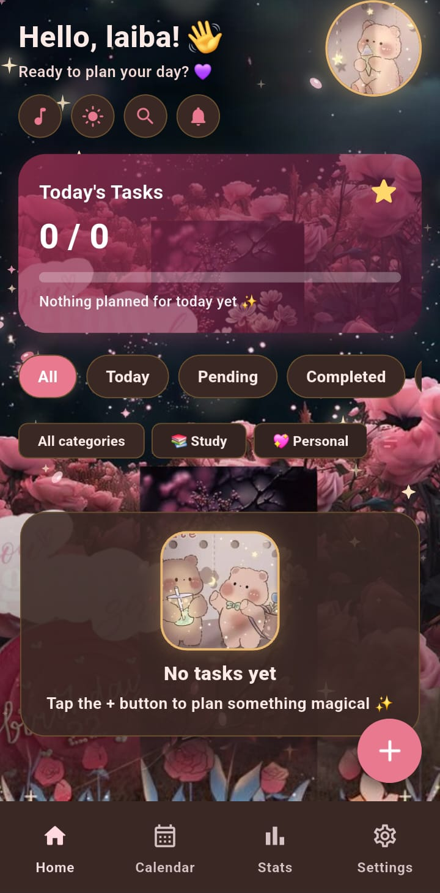</td>
    <td align="center"><b>Calendar</b><br>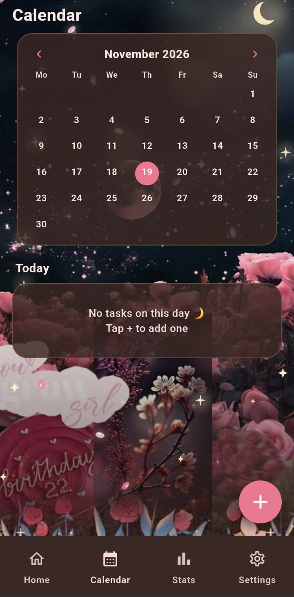</td>
    <td align="center"><b>Add task</b><br>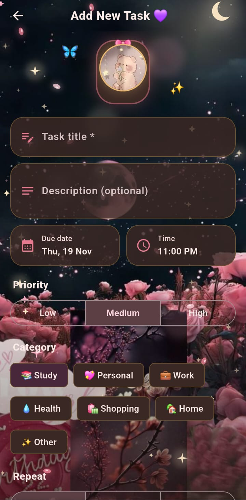</td>
  </tr>
</table>

### Web (Chrome)

| Welcome | Home |
|---|---|
| 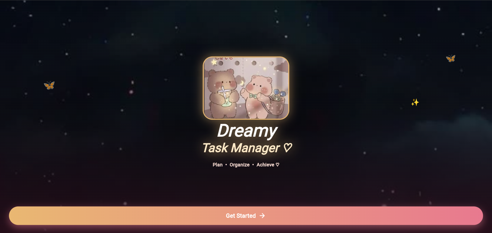 | 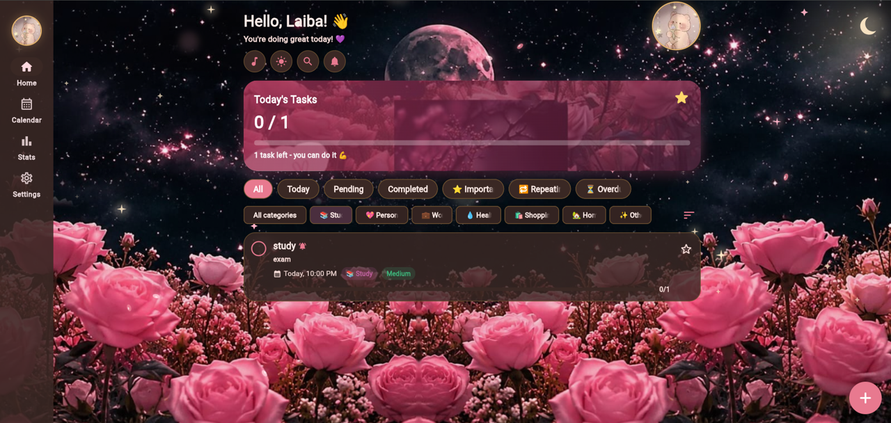 |

| Add task | Task details and subtasks |
|---|---|
| 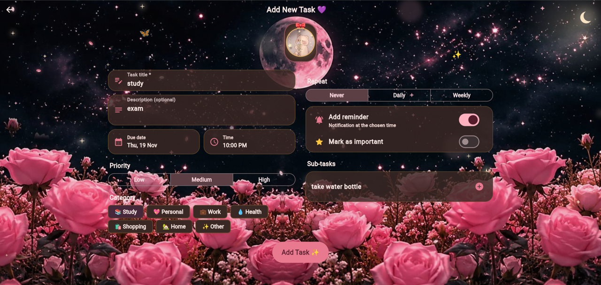 | 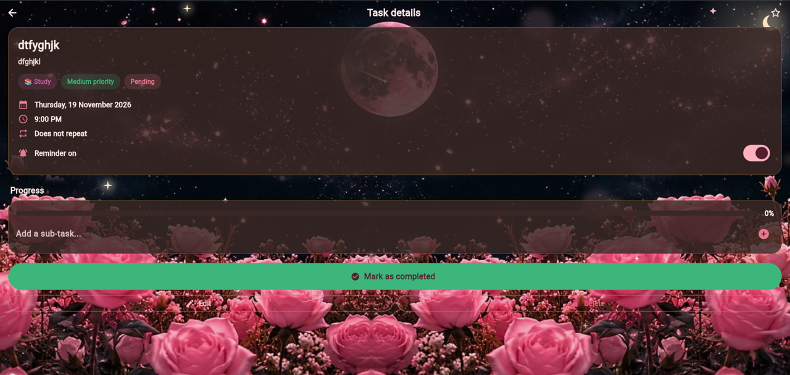 |

| Calendar | Stats |
|---|---|
| 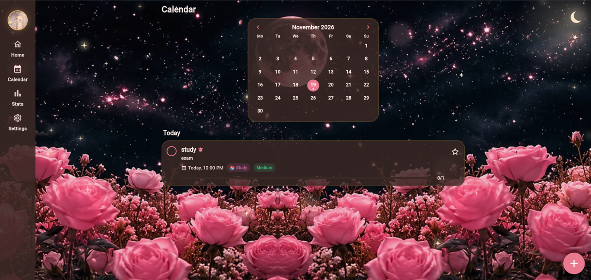 | 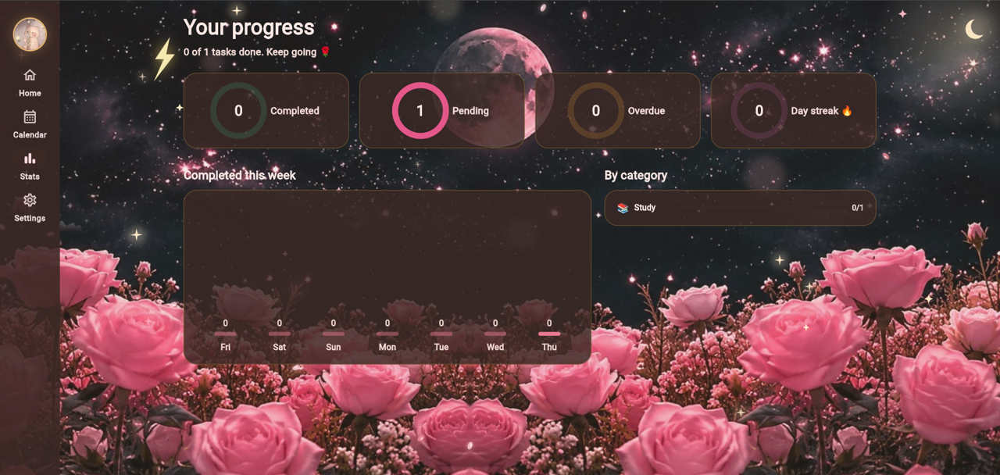 |

| Settings | Export and data |
|---|---|
| 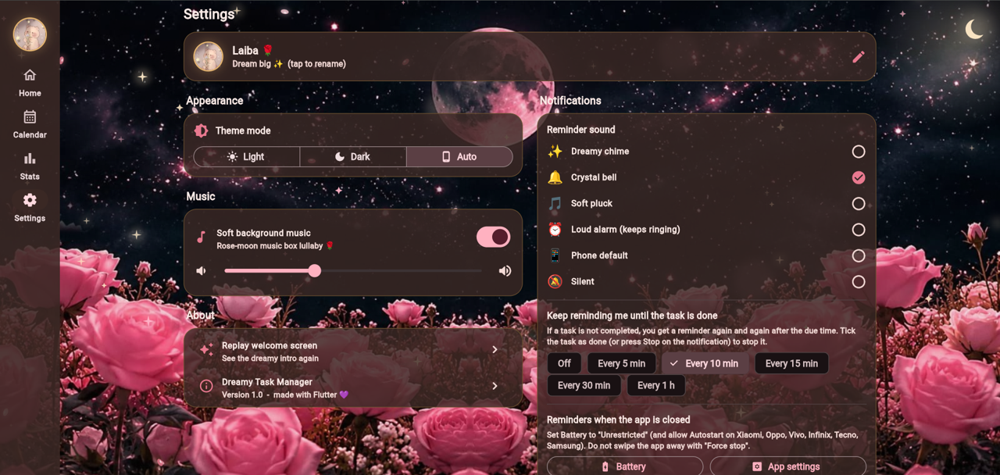 | 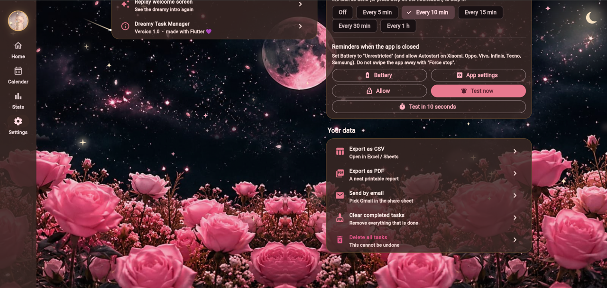 |

| Sort menu | Delete with Undo |
|---|---|
| 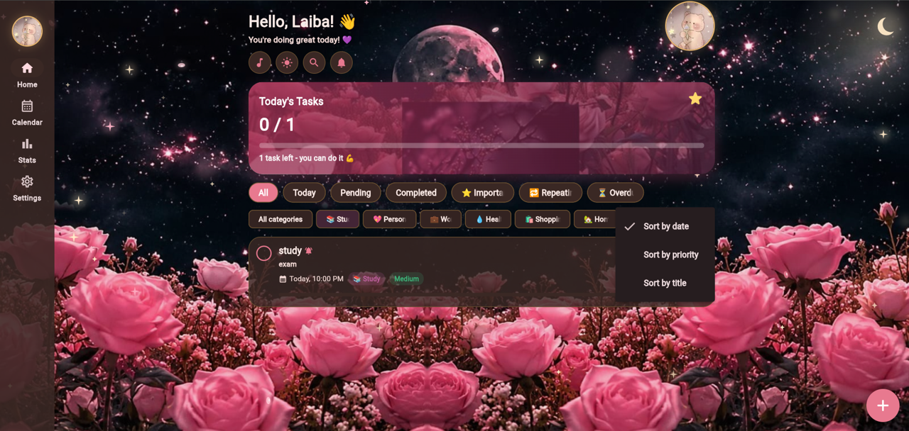 | 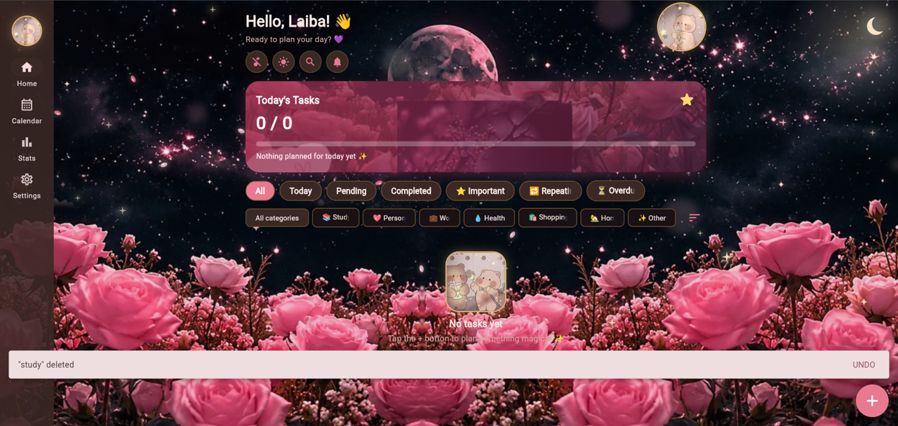 |

---

## ✨ Features

### Task management
- Add tasks with a **title, description, category, priority, due date and time**.
- **Edit** and **delete** tasks. Deleting shows an **Undo** option.
- Mark a task as **completed**. It moves to the *Completed* view automatically.
- Mark tasks as **important** with a star, **search** by text and **sort** by date, priority or title.
- 7 categories: Study, Personal, Work, Health, Shopping, Home and Other.

### Views
- **Today**: tasks due on the current day.
- **Completed**: tasks that are finished.
- **Repeating**: tasks that repeat on selected days or intervals.
- Extra filters: All, Pending, Important, Overdue and a filter for each category.
- **Calendar** tab to see the tasks of any day and add a new one for that day.

### Repeat tasks
- Repeat a task **daily** or on **selected days of the week**.
- When a repeating task is completed, a copy goes to *Completed* and the task moves to its next date with its subtasks reset.

### Progress tracking
- Add **subtasks** to any task and see a **progress bar and percentage**.
- **Stats** tab: completed, pending and overdue counts, day streak, a chart of the last 7 days and progress for each category.

### Notifications
- **Android:** a local reminder at the due time, also when the app is closed. Reminders are restored after the phone restarts.
- **Web:** browser notifications with the chosen sound while the tab stays open (press **Allow** in Settings first).
- **"Still pending" reminders** repeat every 5, 10, 15, 30 or 60 minutes until the task is done.
- Choose the reminder sound: Dreamy chime, Crystal bell, Soft pluck, Loud alarm (keeps ringing), Phone default or Silent.
- Test buttons in Settings to check that reminders work.

### Customization
- **Light, Dark or Auto** theme.
- Reminder sound selection with preview.
- Optional soft background music with a volume slider.
- Your own name on the home screen and a replayable welcome screen.

### Export
- Export all tasks as **CSV** or **PDF**.
- **Android:** the file opens in the share sheet, so you can **send it by email** (Gmail or any other app).
- **Web:** the file is saved with a normal browser download.
- **Clear completed tasks** or **delete all tasks** from Settings.

---

## ✅ Project requirements checklist

| Requirement | Status | Where |
|---|---|---|
| Flutter project and SQLite setup | ✅ | `pubspec.yaml`, `lib/db.dart` |
| Today / Completed / Repeated views | ✅ | `lib/home_page.dart` |
| Add tasks (title, description, due date, repeat) | ✅ | `lib/task_form_page.dart` |
| Edit tasks | ✅ | `lib/task_form_page.dart` |
| Delete tasks | ✅ | `lib/home_page.dart`, `lib/task_detail_page.dart` |
| Mark as completed, moves to Completed | ✅ | `lib/app_state.dart` |
| Light / dark theme | ✅ | `lib/main.dart`, `lib/settings_page.dart` |
| Notification sounds | ✅ | `lib/notifier.dart`, `assets/sounds/` |
| Subtasks with progress bar / percentage | ✅ | `lib/task_detail_page.dart` |
| Export CSV, PDF and email | ✅ | `lib/exporter.dart`, `lib/settings_page.dart` |
| Repeat daily or on selected weekdays, auto reset | ✅ | `lib/models.dart` |
| Local notifications for due dates and times | ✅ | `lib/notifier.dart` |
| Testing | ✅ | `test/task_logic_test.dart`, [`TESTING.md`](TESTING.md) |
| Documentation and APK | ✅ | this README, [`USER_MANUAL.md`](USER_MANUAL.md), `release/` |

---

## 🛠 Tech stack

| Purpose | Package |
|---|---|
| UI and logic | Flutter (Material 3) |
| Local database | `sqflite`, `path` |
| State management | `provider` |
| Notifications | `flutter_local_notifications`, `timezone`, `flutter_timezone` |
| Sounds and music | `audioplayers` |
| Export and sharing | `pdf`, `share_plus`, `intl` |

## 🗄 Database

SQLite database (`dreamy_tasks.db`) with three tables:

| Table | Content |
|---|---|
| `tasks` | title, description, category, priority, due date, done flag, reminder flag, important flag, repeat type, repeat days, completed time, created time |
| `subtasks` | title, done flag, linked task id |
| `settings` | key/value pairs (theme, name, sound, music, volume) |

> SQLite is used on Android. In the browser, where SQLite is not available, the same data is stored as JSON in the browser's `localStorage`.

## 📁 Project structure

```
lib/
  main.dart              app start, theme and notifications setup
  splash_page.dart       welcome screen
  shell_page.dart        navigation (Home, Calendar, Stats, Settings)
  home_page.dart         task list, filters, search, sorting
  task_form_page.dart    add / edit task
  task_detail_page.dart  details, subtasks and progress
  calendar_page.dart     calendar view
  stats_page.dart        progress and statistics
  settings_page.dart     theme, music, sounds, export, data
  app_state.dart         state, settings, music, task actions
  db.dart                SQLite access (and web storage)
  models.dart            Task and Subtask, repeat logic
  notifier.dart          reminders, follow-ups, alarm
  exporter.dart          CSV and PDF export
  art.dart, widgets.dart themed background and shared widgets
  web_*.dart             web-only helpers (storage, notifications, download)
assets/                  images, music and notification sounds
test/                    unit tests
docs/screenshots/        screenshots used in this README
```

## 🚀 Run the project

Requirements: Flutter SDK (Dart ^3.13). For Android you also need Android Studio and a phone or emulator.

```bash
git clone https://github.com/laiba-shahid34/task_manager.git
cd task_manager
flutter pub get
```

Run on Android:

```bash
flutter run
```

Run in the browser:

```bash
flutter run -d chrome
```

Build the Android APK:

```bash
flutter build apk --release
```

The APK is created at `build/app/outputs/flutter-apk/app-release.apk`.

Run the tests:

```bash
flutter test
```
> 🎥 **Video demo:** [Watch the demo on Google Drive](https://drive.google.com/file/d/1OKb4TgAEFt_M_N2R2N5o9Pcb9B32pOQp/view?usp=drivesdk)

## 🔔 Notes about reminders

- **Android:** allow notifications and set the app's battery usage to **Unrestricted** (on Xiaomi, Oppo, Vivo, Infinix and Tecno also allow *Autostart*; on Samsung add the app to *Never sleeping apps*). Do not use *Force stop*, because Android removes all alarms of a force-stopped app.
- **Web:** keep the browser tab open to receive reminders.

---

Made with Flutter 💜 by **Laiba**
