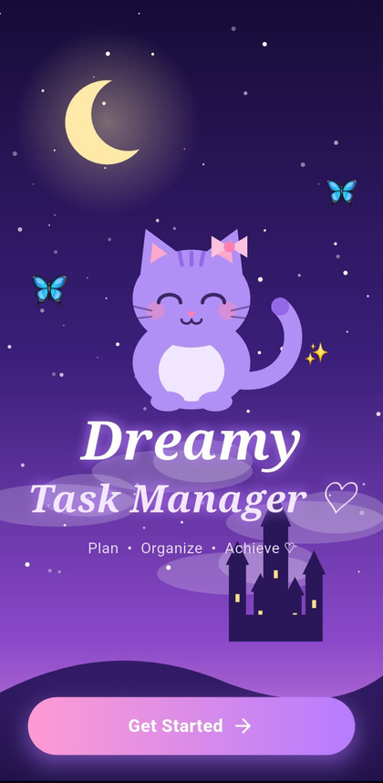
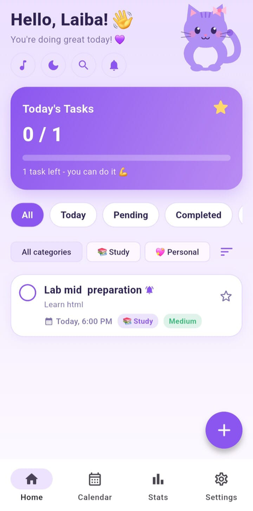
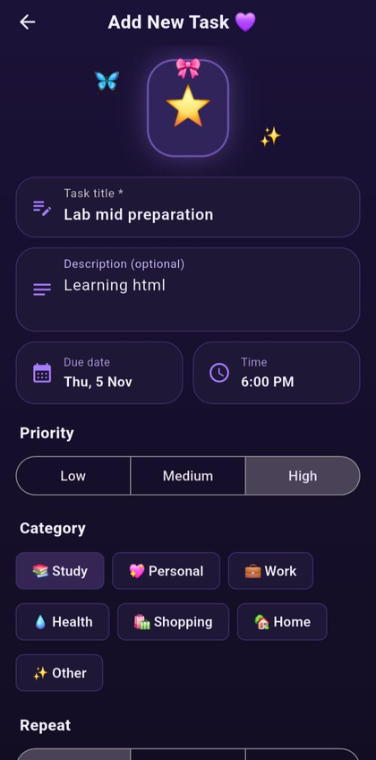
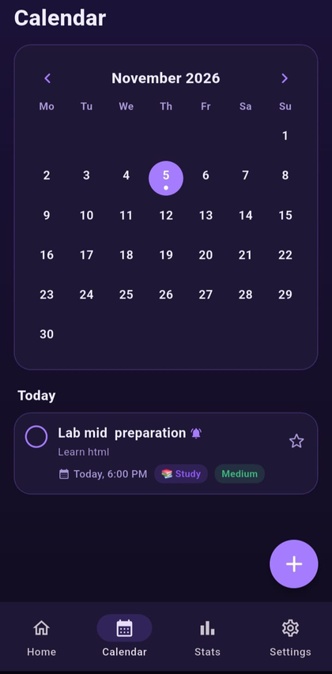
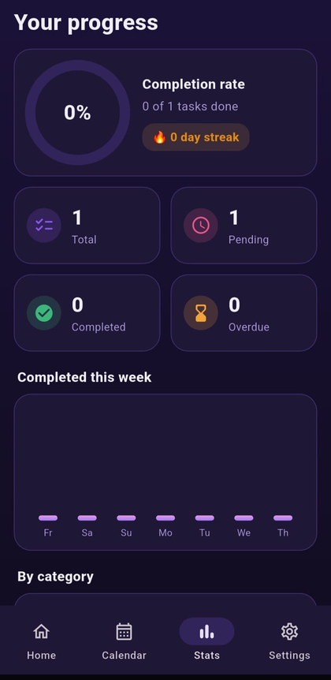
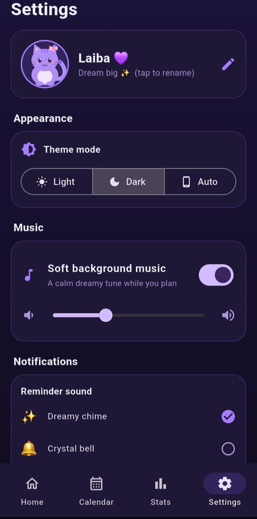
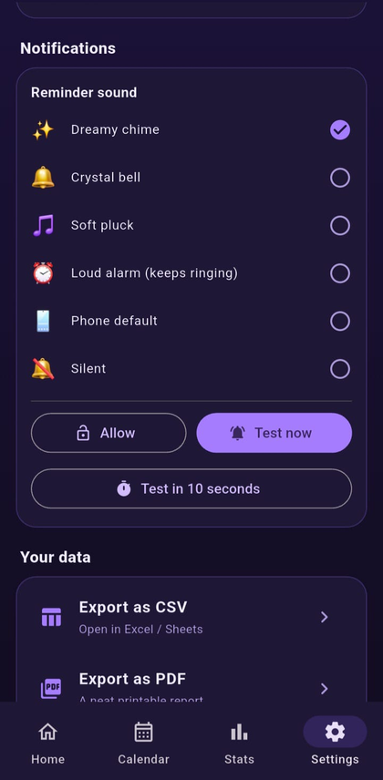

# Dreamy Task Manager

A task management app built with **Flutter** and **SQLite**. Plan your day, repeat tasks, track progress with subtasks, get reminders (even when the app is closed) and export your tasks as CSV or PDF.

> Video demo: **ADD YOUR LINK HERE** (YouTube / Google Drive)
> Download the app: [`release/task_manager.apk`](release/task_manager.apk)

## Screenshots

| Welcome | Home | Add task | Calendar |
|---|---|---|---|
|  |  |  |  |

| Stats | Settings | Reminder sounds |
|---|---|---|
|  |  |  |

## Features

**Task management**
- Add tasks with title, description, category, priority, due date and time.
- Edit and delete tasks (swipe to delete, with an **Undo** option).
- Mark tasks as completed. They move to the **Completed** view automatically.
- Mark important tasks with a star and search tasks by text.

**Views**
- **Today**: tasks due on the current day.
- **Completed**: tasks that are finished.
- **Repeating**: tasks that recur on specific days or intervals.
- Extra filters: All, Pending, Important and Overdue.
- **Calendar** tab to see and add tasks for any day.

**Repeat tasks**
- Repeat **daily** or on **selected days of the week**.
- When a repeating task is completed, a copy goes to Completed and the task moves to its next date with the subtasks reset.

**Progress tracking**
- Add subtasks to any task and see a progress bar and percentage.
- **Stats** tab with completed/pending/overdue counts, a daily streak and a chart of the last days.

**Notifications**
- Local reminder at the task's due time. Works when the app is closed and is restored after a phone restart.
- "Still pending" follow-up reminders if the task is not completed: after **10 minutes, 1 hour, 1 day and 1 week**. They are cancelled as soon as the task is completed.
- Choose the reminder sound: Dreamy chime, Crystal bell, Soft pluck, Phone default, Silent or a **Loud alarm** that keeps ringing until dismissed.
- Test buttons in Settings to check that notifications work.

**Customization**
- Light, dark or system theme.
- Notification sound selection with preview.
- Optional background music with volume control.
- Your name on the home screen.

**Export**
- Export all tasks as **CSV** or **PDF**.
- **Send by email**: opens the share sheet so you can pick Gmail or any other app.

## Tech stack

| Purpose | Package |
|---|---|
| UI and logic | Flutter (Material 3) |
| Local database | `sqflite`, `path` |
| State management | `provider` |
| Notifications | `flutter_local_notifications`, `timezone` |
| Sounds and music | `audioplayers` |
| Export | `pdf`, `share_plus`, `intl` |

## Database

SQLite database with three tables:

| Table | Content |
|---|---|
| `tasks` | title, description, category, priority, due date, done flag, reminder flag, important flag, repeat type, repeat days, completed time, created time |
| `subtasks` | title, done flag, linked task id |
| `settings` | key/value pairs (theme, name, sound, music, volume) |

## Project structure

```
lib/
  main.dart            app start, theme and notifications setup
  app_state.dart       state, settings, music, task actions
  db.dart              SQLite access
  models.dart          Task and Subtask, repeat logic
  notifier.dart        reminders, follow-ups, alarm
  exporter.dart        CSV and PDF export
  home_page.dart       task list, filters, search
  calendar_page.dart   calendar view
  stats_page.dart      progress and statistics
  task_form_page.dart  add / edit task
  task_detail_page.dart  details and subtasks
  settings_page.dart   theme, sounds, export, data
  splash_page.dart     welcome screen
assets/                music and notification sounds
test/                  unit tests
docs/                  screenshots
```

## Run the project

Requirements: Flutter SDK, Android Studio and an Android phone (or emulator).

```
git clone https://github.com/laiba-shahid34/task_manager.git
cd task_manager
flutter pub get
flutter run
```

Build the APK:

```
flutter build apk --release
```

The APK is created at `build/app/outputs/flutter-apk/app-release.apk`.

Run the tests:

```
flutter test
```

## Documentation

- [User manual](USER_MANUAL.md)
- [Testing report](TESTING.md)

## Notes for reminders on Android

For reminders to work when the app is closed, allow notifications and set the app's battery usage to **Unrestricted** in the phone settings (on Samsung phones also add it to *Never sleeping apps*). Do not use *Force stop*, because Android removes all alarms of a force-stopped app.
